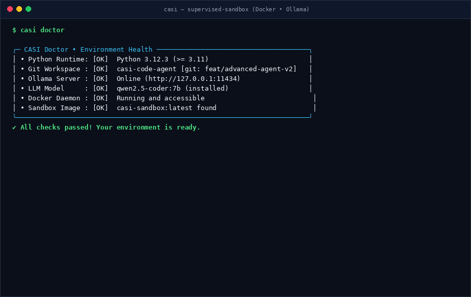

# 🛡️ CASI — Code Agent for Software Inspection

> **Local, privacy-first AI coding agent with isolated Docker sandbox verification and mandatory human-in-the-loop approval.**

[](https://www.python.org/)
[](https://ollama.ai)
[](https://www.docker.com/)
[](docs/reports/2026-09-18-development-orchestration.md)
[](LICENSE)

CASI is an open-source, local agent designed for supervised repository work. It inspects your codebase, diagnoses issues, proposes multi-file patches, verifies changes in a sandboxed Docker container, and **never touches your real files without explicit human approval**.

<p align="center">
  
</p>

---

## ⚡ Why CASI?

Unlike cloud-based AI tools that upload proprietary code or CLI agents that blindly execute unchecked commands on your host system:

| Feature | Cloud Agents (Copilot, Cursor) | Unconstrained CLI Agents | CASI |
| :--- | :--- | :--- | :--- |
| **Code Privacy** | Uploaded to third-party servers | Model-dependent | 🔒 **100% Local** via Ollama (OpenAI optional) |
| **Test Execution** | Local host or remote VM | Unrestricted host machine | 🐳 **Zero-Network Docker Sandbox** (isolated container) |
| **Workspace Safety** | Direct writes to working tree | Direct unreviewed writes | 🌿 **Ephemeral Git Worktrees** (`.casi/worktrees/`) |
| **Patch Application** | Auto-applied or partial review | Autonomous modification | ✋ **Human Gatekeeper** (`apply_patch` is forbidden to LLM) |
| **Undo / Rollback** | Manual `git checkout` | Manual git recovery | ⏪ **Native `/undo`** via LIFO patch memento stack |
| **Role Specialization**| Single generic prompt | Single generic prompt | 🎭 **7 Specialized Personalities** (Fix, Create, Diagnose...) |

---

## 🔄 How CASI Works

```text
  User Request (CLI / API / UI)
           │
           ▼
  ┌─────────────────────────────────┐
  │  Task Evaluator & Refiner       │  Disambiguates task with repository context
  │  (Role: Fix, Create, Diagnose)  │  (Consumes 0 agent decision steps)
  └────────────────┬────────────────┘
                   │
                   ▼
  ┌─────────────────────────────────┐
  │  Bounded Agent Loop             │  Executes safe tools:
  │  (read, search, propose_file)   │  • read_file, search_code, list_files
  └────────────────┬────────────────┘
                   │ propose_file (staged in ephemeral worktree)
                   ▼
  ┌─────────────────────────────────┐
  │  Sandboxed Test Verification    │  Copy-on-run in Docker container
  │  (No network, memory limits)    │  Pytest runs against patched worktree
  └────────────────┬────────────────┘
                   │ Tests pass (or max retries reached)
                   ▼
  ┌─────────────────────────────────┐
  │  Human Review & Gatekeeper      │  Unified diff presentation
  │  [y / N / v / save / ?]         │  Human decides whether to apply
  └────────────────┬────────────────┘
                   │ Approved [y]
                   ▼
             apply_patch
     (clean write to user repository)
```

> [!IMPORTANT]
> The `apply_patch` operation is **never** callable by the AI model. Code proposals must pass sandbox verification and receive your explicit approval before any repository file is modified.

---

## 🚀 Examples & Walkthroughs

### 1. Autonomous Bug Fixing (`casi fix`)

Ask CASI to diagnose and resolve an issue. CASI identifies the problem, reproduces the failure in a Docker sandbox, prepares a fix in an isolated worktree, re-runs tests to verify the fix, and presents a colorized diff:

```bash
casi fix --repo . --task "Fix ZeroDivisionError in calculate_metrics when dataset is empty"
```

**Terminal output:**

```text
╭─ CASI Task Interpreter ───────────────────────────────────────────────────╮
│ 🎯 Refined Task : Handle empty values list in calculate_metrics()          │
│ 🤖 Persona      : Fix Specialist                                          │
│ 🧠 Model        : qwen2.5-coder:7b (via Ollama)                           │
╰───────────────────────────────────────────────────────────────────────────╯

├─ [Step 1/5] 🔍 search_code("def calculate_metrics")
│             └─ Found in src/analytics/metrics.py:28
├─ [Step 2/5] 📖 read_file("src/analytics/metrics.py", start=25, end=45)
├─ [Step 3/5] 🧪 run_tests() [Docker Sandbox: casi-sandbox:latest]
│             └─ ❌ FAILED tests/test_metrics.py::test_empty_dataset
│                Traceback: ZeroDivisionError: division by zero at line 34
├─ [Step 4/5] ✏️  propose_file("src/analytics/metrics.py") [Worktree: .casi/worktrees/task_8f1b]
├─ [Step 5/5] 🧪 re-run tests in sandbox with proposed fix...
              └─ ✅ 18 passed in 0.38s

Proposed Patch:
─────────────────────────────────────────────────────────────────────────────
--- a/src/analytics/metrics.py
+++ b/src/analytics/metrics.py
@@ -32,4 +32,6 @@ def calculate_metrics(values: list[float]) -> dict:
+    if not values:
+        return {"count": 0, "mean": 0.0, "variance": 0.0}
     mean = sum(values) / len(values)
     variance = sum((x - mean) ** 2 for x in values) / len(values)
─────────────────────────────────────────────────────────────────────────────

Apply this patch to your repository? [y/N/v/save/?]: y
✅ Patch applied cleanly to src/analytics/metrics.py (1 file changed, 2 insertions(+))
```

---

### 2. Interactive Terminal Session (`casi interactive`)

Launch a stateful REPL with auto-completion, multi-turn conversation, diff inspection, and instant rollback:

```bash
casi interactive --repo .
```

```text
╭─ CASI ──────────────────────────────────────────────────────────────────── v0.1.0 ─╮
│   ____ ___    _____ ____                                                           │
│  / __//   |  / ___//  _/   CASI • Local AI Software Engineer                       │
│ / /  / /| |  \__ \ / /     Model   : qwen2.5-coder:7b (ollama • assist)            │
│ / /__/ ___ | ___/ // /     Sandbox : Docker isolated (casi-sandbox:latest)         │
│ \___/_/  |_|/____//___/    Repo    : casi-code-agent [git: main]                    │
│                                                                                    │
│  Guard   : apply_patch requires human confirmation [y/N/v/save/?]                  │
│  Commands: /help • /status • /explain • /diff • /undo • /exit                      │
│  Hint    : Type @file to autocomplete paths with Tab                               │
╰────────────────────────────────────────────────────────────────────────────────────╯

casi ❯ /explain src/casi/agent/orchestrator.py
  ├─ 1. Role & Boundaries: Coordinates multi-step plans across specialized agent roles
  ├─ 2. Key Components   : Step budget, context compaction, trace hooks, verification
  ├─ 3. Dependencies     : LLMClient, ToolRegistry, WorktreeManager
  ├─ 4. Invariants       : apply_patch is never exposed to model; sandboxed tests first
  └─ 5. Extension Points : Custom personas in profiles.py, custom tool handlers

casi ❯ Add input validation to @src/api/auth.py and update its tests
  [CASI stages patch in worktree -> verifies with Pytest in Docker -> tests pass]
  Apply this patch? [y/N/v/save/?]: y
  ✅ Applied patch to src/api/auth.py and tests/test_auth.py

casi ❯ /diff
  [Shows active session unified diff]

casi ❯ /undo
  ⏪ Reverted last patch (restored src/api/auth.py, tests/test_auth.py)

casi ❯ /status
  ╭─ System Status ────────────────────────────────────────────────────╮
  │ • Repository   : /home/fenic/workspace/casi-code-agent             │
  │ • Git Branch   : main                                              │
  │ • Model        : qwen2.5-coder:7b (Provider: ollama)               │
  │ • Sandbox      : Docker (casi-sandbox:latest, pids=64)            │
  │ • Undo Stack   : 0 patch(es) recorded                             │
  ╰────────────────────────────────────────────────────────────────────╯
```

**Built-in REPL commands:**
- `/explain <path>` — Architectural analysis using standard 5-section breakdown.
- `@<path>` — Path auto-completion with Tab.
- `/diff` — Inspect generated diffs.
- `/undo` — Revert the last applied patch via `PatchMementoStack`.
- `/stats` — View token metrics, step budget, and sandbox test executions.
- `/compact` — Compress conversation history to stay within LLM context limits.
- `/trace [on|off]` — Toggle real-time decision logging.

---

### 3. Visual Dashboard & REST API (`casi serve` + `casi ui`)

Prefer a graphical interface? CASI includes a FastAPI server and a modular Streamlit UI:

```bash
# Terminal 1: Start the API server
casi serve --port 8000

# Terminal 2: Launch the Streamlit interface
casi ui --api-url http://127.0.0.1:8000
```

- **Live Traces**: Watch agent decisions, tool invocations, and thinking logs in real time.
- **Diff Viewer**: Review highlighted diffs before approving or rejecting patches.
- **Clarification Dialog**: Interactively respond when the agent requests guidance.
- **Session History**: Track past tasks, verification metrics, and sandbox logs.

---

## 📦 Quick Start

### Installation

Requires **Python 3.11+**.

```bash
# Clone the repository
git clone https://github.com/fenic/casi-code-agent.git
cd casi-code-agent

# Install with API and UI extras
pip install -e ".[api,ui]"

# (Recommended) Build the isolated Docker sandbox image
docker build -t casi-sandbox:latest -f docker/sandbox.Dockerfile .

# Verify your setup in 1 second
casi doctor
```

### Basic Commands

| Command | Description | Example |
| :--- | :--- | :--- |
| `casi doctor` | Validate Ollama, Docker sandbox, and environment health | `casi doctor` |
| `casi inspect` | Safely list repository files (respects ignores) | `casi inspect --repo .` |
| `casi read` | Read file contents with line numbers | `casi read --repo . --file src/app.py` |
| `casi search` | Fast text/symbol search across the repo | `casi search --repo . --query "def authenticate"` |
| `casi ask` | Read-only analysis and architecture questions | `casi ask --repo . --task "How does auth work?"` |
| `casi fix` | Targeted diagnosis, repair, and sandbox testing | `casi fix --repo . --task "Fix pytest failures"` |
| `casi run` | General task execution with agent orchestration | `casi run --repo . --task "Add docstrings to api.py"` |
| `casi interactive` | Stateful terminal session with `/undo` and `@file` | `casi interactive --repo .` |
| `casi test` | Run repository tests directly in sandbox | `casi test --repo .` |

---

## ⚙️ Configuration & Providers

CASI defaults to **Ollama** (`qwen2.5-coder:7b`) for a private, 100% offline workflow. You can also use OpenAI or configure custom models via CLI flags, environment variables, or `casi.toml`:

### CLI Flags
```bash
# Use a specific Ollama model
casi fix --repo . --model qwen2.5-coder:14b --task "..."

# Use OpenAI GPT-4o
export OPENAI_API_KEY="sk-..."
casi run --repo . --provider openai --model gpt-4o --task "..."
```

### Configuration File (`casi.toml`)
```toml
[llm]
provider = "ollama"               # "ollama" or "openai"
model = "qwen2.5-coder:7b"
temperature = 0.0

[sandbox]
use_docker = true
docker_image = "casi-sandbox:latest"
timeout_seconds = 60.0
pids_limit = 64

[agent]
routing_mode = "assist"           # "assist", "strict", or "off"
max_steps = 15
```

---

## 🧪 Development & Benchmark Suite

CASI includes an independent acceptance benchmark suite with 12 complex real-world tasks (ML algorithms, CSV parsing, dependency graphs, slug sanitization, API contracts).

```bash
# Sync dependencies
uv sync --locked --group dev

# Run linters and typecheckers
uv run --no-sync ruff check src tests benchmarks/development
uv run --no-sync ruff format --check src tests benchmarks/development
uv run --no-sync python -m compileall -q src tests

# Run unit and integration tests
uv run --no-sync pytest -ra

# (Optional) Run real-model end-to-end integration test
OLLAMA_E2E=1 uv run --no-sync pytest tests/integration/test_ollama_repair.py -ra
```

---

## 📚 Documentation

| Document | Description |
| :--- | :--- |
| [ARCHITECTURE.md](ARCHITECTURE.md) | Component architecture, agent state machine, and boundaries |
| [AGENTS.md](AGENTS.md) | Guidelines and rules for autonomous AI contributors |
| [TASKS.md](TASKS.md) | Roadmap, completed milestones, and active tasks |
| [docs/security.md](docs/security.md) | Sandbox security model, permissions, and attack mitigation |
| [docs/evaluation.md](docs/evaluation.md) | Benchmark framework, scoring rubrics, and reproducibility |
| [docs/reports/](docs/reports/) | Benchmark evaluation reports and milestone records |

---

## 📄 License

This project is licensed under the [MIT License](LICENSE).
